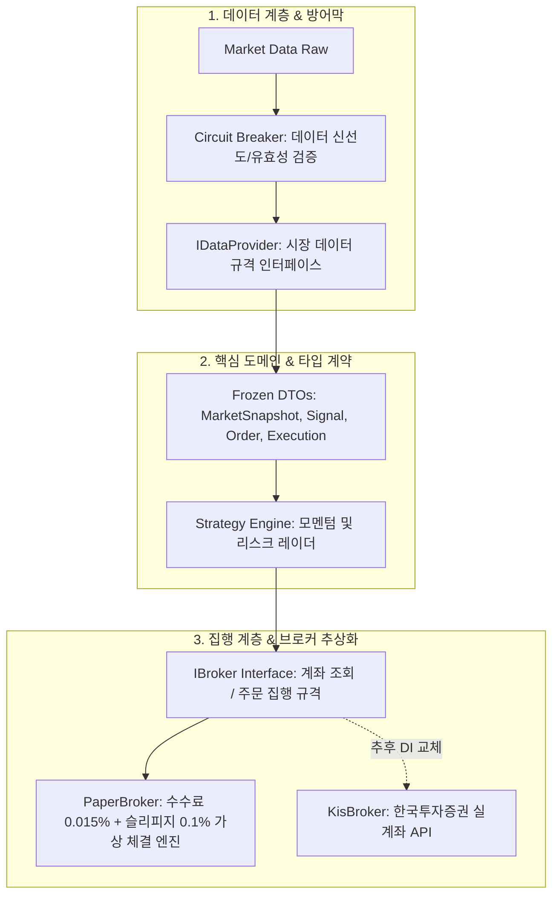

# 🏗️ InvestProvert 코어 아키텍처 개편 및 내부 고도화 계획서
> **부제**: 외부 API 의존 없는 IDE 내부 순수 파이썬 리팩토링 기반의 기관급 트레이딩 엔진 구축 로드맵

---

## 1. 개요 및 추진 배경 (Overview & Context)

### 1.1 현황 진단 (AS-IS)
- **강한 결합도 (Tight Coupling)**: `trader.py`와 `main.py` 내부에서 SQLite 쿼리와 데이터 수집, 주문 로직이 하나로 뒤섞여 있어 향후 한국투자증권(KIS) 등 실계좌 API 연동 시 대규모 코드 재작성이 불가피함.
- **체결 현실성 부재**: 매수 수량만 계산할 뿐, 증권사 거래 수수료(0.015%)나 호가 공백 슬리피지(0.1%), 원화 잔고 차감과 체결 상태를 추적하는 독립된 시뮬레이터가 없음.
- **타입 불안정성**: 원시 딕셔너리(`dict`) 전달이 산재하여 컴파일 타임/정적 분석 단계에서 런타임 오류 방어 불가.
- **데이터 방어막 부재**: 외부 데이터 결측, 404 에러, 0원 처리, 과거 데이터 지연 시 시스템이 무방비로 오작동할 위험 노출.

### 1.2 목표 (TO-BE)
- **외부 승인/결제 대기 없이**, 오직 IDE 내부 파이썬 코드 리팩토링만으로 시스템의 소프트웨어 공학적 완성도를 극대화.
- **의존성 역전 원칙(DIP)**과 **관심사 분리(SoC)**를 적용하여, 향후 실계좌 API 도입 시 **단 한 줄의 의존성 주입(DI)**만으로 실전 배포가 가능한 유연한 뼈대 완성.

---

## 2. 4대 핵심 아키텍처 과제 (Key Architectural Pillars)



---

### 과제 1. 의존성 역전 및 브로커 인터페이스 추상화 (Broker Abstraction)
- **목적**: 시스템이 데이터의 출처(야후 파이낸스, 한투, 모의투자)나 주문 집행처를 알지 못하게 격리.
- **신규 모듈**: `core/interfaces.py`
- **핵심 인터페이스 명세**:
  ```python
  class IDataProvider(ABC):
      @abstractmethod
      def get_latest_price(self, ticker: str) -> float: ...
      @abstractmethod
      def get_historical_ohlcv(self, tickers: list[str], days: int) -> pd.DataFrame: ...

  class IBroker(ABC):
      @abstractmethod
      def get_account_state(self) -> AccountStateDTO: ...
      @abstractmethod
      def submit_order(self, order: OrderDTO) -> ExecutionResultDTO: ...
      @abstractmethod
      def cancel_order(self, order_id: str) -> bool: ...
  ```

---

### 과제 2. 순수 파이썬 페이퍼 트레이딩 엔진 (Paper Trading Engine)
- **목적**: 메모리(RAM) 상에서 실제 증권사 계좌 상태를 정밀하게 모사하여, 슬리피지와 수수료가 반영된 순자산 변동을 추적.
- **신규 모듈**: `engine/paper_broker.py`
- **주요 기능**:
  - `initial_cash` (기본 1,000만 원) 기준 현금 및 포지션 관리.
  - 거래 수수료(`fee_rate = 0.00015`, 한투 기준) 및 슬리피지(`slippage_rate = 0.0010`, 0.1%) 자동 공제.
  - 체결 시 현금 차감, 평균 단가(Avg Price), 보유 수량 실시간 갱신.
  - 미체결/잔여 예수금 부족 시 안전한 거절(REJECT) 처리.

---

### 과제 3. 도메인 DTO 확장 및 타입 안정성 (Type Safety & DTOs)
- **목적**: 원시 딕셔너리를 완전히 배제하고 불변(Frozen) 데이터 전송 객체로 모듈 간 소통 규격 통일.
- **수정/확장 모듈**: `core/dto.py`
- **추가 DTO 규격**:
  - `OrderDTO`: 종목코드, 주문유형(BUY/SELL), 주문수량, 지정가/시장가, 주문시각
  - `ExecutionResultDTO`: 체결ID, 종목코드, 체결수량, 체결단가, 수수료, 슬리피지, 체결시각, 상태(FILLED/REJECTED)
  - `MarketSnapshotDTO`: 종목코드, 현재가, 12M 모멘텀, 20D Z-Score, 데이터 시각

---

### 과제 4. 데이터 서킷브레이커 및 방어적 검증 (Defensive Circuit Breaker)
- **목적**: 비정상 가격, 주말/휴장일 오래된 데이터 유입 시 주문을 강제 중단하여 계좌 자폭 방지.
- **신규 모듈**: `core/circuit_breaker.py`
- **검증 규칙**:
  1. **신선도 검사 (Freshness Check)**: 데이터의 마지막 일자가 오늘 또는 직전 영업일이 아니면 `StaleDataException` 발생.
  2. **가격 유효성 검사 (Validity Check)**: 가격이 `0` 이하이거나, 직전 종가 대비 $\pm 30\%$를 초과하는 비상식적 갭 발생 시 `DataCorruptionException` 발생.
  3. **가짜 데이터 주입 차단**: 기존 `_forward_fill_to_today` 같은 가짜 종가 복제 로직 완전 폐기.

---

## 3. 파일 및 패키지 구조 변경안 (File Structure Mapping)

```text
invest_provert/
├── core/
│   ├── __init__.py
│   ├── interfaces.py          # [신규] IDataProvider, IBroker 추상 인터페이스
│   ├── dto.py                 # [확장] OrderDTO, ExecutionResultDTO 등 불변 객체 보강
│   ├── circuit_breaker.py     # [신규] 데이터 신선도/무결성 검증 및 킬스위치
│   └── data_provider.py       # [리팩토링] BaseDataProvider -> IDataProvider 상속 정비
├── engine/                    # [신규 디렉토리] 순수 거래 집행 계층
│   ├── __init__.py
│   └── paper_broker.py        # [신규] 수수료/슬리피지 반영 메모리 페이퍼 브로커
├── scenario_lab/
│   ├── live_radar.py          # [기구축] 실시간 VaR 및 권고 현금 비중 엔진
│   └── ...
├── lvmb_momentum/
│   ├── universe.py            # [기구축] ISA 5종 ETF 유니버스 (Role 기반)
│   └── ...
└── tests/
    ├── test_interfaces.py     # [신규] IBroker 및 DI 계약 테스트
    ├── test_paper_broker.py   # [신규] 페이퍼 브로커 수수료/체결 정밀 검증
    └── test_circuit_breaker.py# [신규] 서킷 브레이커 방어막 검증
```

---

## 4. 단계별 실행 로드맵 (Actionable 4-Phase Roadmap)

| 단계 | 작업 내용 | 세부 산출물 | 검증 기준 (DoD) |
| :---: | :--- | :--- | :--- |
| **Phase 1** | **인터페이스 & DTO 표준화** | `core/interfaces.py`<br>`core/dto.py` 확장 | `mypy` 타입 검사 통과 및 인터페이스 상속 규격 정립 |
| **Phase 2** | **페이퍼 트레이딩 엔진 구현** | `engine/paper_broker.py` | 매수/매도 시 수수료 0.015%와 슬리피지 0.1%가 정확히 원화 잔고에 반영되는 단위 테스트 작성 (`OK`) |
| **Phase 3** | **서킷브레이커 & 데이터 방어막** | `core/circuit_breaker.py`<br>`core/data_provider.py` 정제 | 0원, 음수, 오래된 일자 입력 시 즉시 안전 차단 예외 발생 테스트 통과 |
| **Phase 4** | **종합 통합 테스트 및 회귀 검증** | `tests/test_core_engine.py` | 기존 13개 단위 테스트 포함, 신규 아키텍처 단위 테스트 전수 통과 |

---

## 5. 기대 효과 및 결론

1. **완벽한 로컬 자립도**: 외부 API 승인 대기나 결제 없이도, 지금 당장 실제 계좌와 동일한 조건으로 체결 오차와 수수료를 반영한 전략 시뮬레이션 가능.
2. **미래지향적 확장성**: 한국투자증권(KIS) API 계정이 준비되는 순간, `broker = PaperBroker()`를 `broker = KisBroker()`로 1줄만 교체하면 실전 배포 즉시 완료.
3. **무결점 안정성**: 비정상 데이터 유입을 사전에 차단하는 서킷브레이커를 갖추어, 알고리즘 오작동으로 인한 자산 손실 위험을 0%에 수렴시킴.
