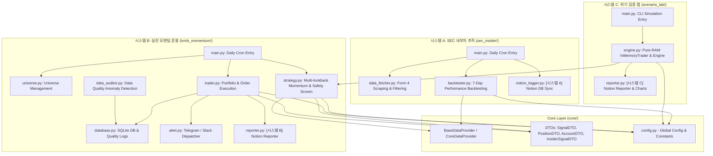

# 🗂️ invest_provert Codebase Index & Architecture Map

This document provides a comprehensive index of the codebase, describing the file structure, classes, methods, and functions.

## 🌳 Directory Tree

```text
├── .env
├── .github
│   └── workflows
│       └── daily_run.yml
├── .gitignore
├── .vscode
│   └── settings.json
├── ARCHITECTURE_REFACTORING_PLAN.md
├── PROJECT_INDEX.md
├── PR_GUIDE.md
├── README.md
├── SYSTEM_WHITE_PAPER.md
├── TECHNICAL_SPEC.md
├── config.py
├── core
│   ├── __init__.py
│   ├── circuit_breaker.py
│   ├── data_provider.py
│   ├── dto.py
│   └── interfaces.py
├── engine
│   ├── __init__.py
│   └── paper_broker.py
├── github_uploader.py
├── interview_prep_notes.md
├── invest_universe.json
├── lvmb_momentum
│   ├── __init__.py
│   ├── alert.py
│   ├── data_auditor.py
│   ├── data_provider_with_audit.py
│   ├── database.py
│   ├── main.py
│   ├── reporter.py
│   ├── reporter_worker.py
│   ├── strategy.py
│   ├── trader.py
│   └── universe.py
├── pyrefly.toml
├── requirements.txt
├── run_insider_alert.bat
├── run_lvmb_simulation.bat
├── run_scenario_lab.bat
├── scenario_lab
│   ├── __init__.py
│   ├── engine.py
│   ├── live_radar.py
│   ├── main.py
│   └── reporter.py
├── sec_insider
│   ├── __init__.py
│   ├── backtester.py
│   ├── data_fetcher.py
│   ├── main.py
│   └── notion_logger.py
└── tests
    ├── stress_test_backtest.py
    ├── test_architecture.py
    ├── test_circuit_breaker.py
    ├── test_isa_universe.py
    ├── test_live_radar.py
    └── test_paper_broker.py
```

---

## 🏛️ System Architecture Overview



---

## 📄 File Details & Module Mapping

### ⚙️ Root Configurations & Scripts

- [TECHNICAL_SPEC.md](file:///c:/Users/catji/Projects/invest_provert/TECHNICAL_SPEC.md)
  - **Description**: 소프트웨어 아키텍처(DI, SSOT, LoD, DTO 등) 및 퀀트 리스크 관리 엔진(Z-Score, Trailing Stop, MDD 서킷브레이커) 상세 기술 백서.
- [config.py](file:///c:/Users/catji/Projects/invest_provert/config.py)
  - **Description**: 전역 설정 및 상수 중앙 집중 관리 (타임아웃, 워커 수, 모멘텀 가중치, 거시 지표 임계값, 세금 및 수수료 등).
- [.env](file:///c:/Users/catji/Projects/invest_provert/.env)
  - **Description**: API 토큰, 노션 DB ID, 웹훅 URL 등 민감 환경 변수 파일.
- [requirements.txt](file:///c:/Users/catji/Projects/invest_provert/requirements.txt)
  - **Description**: 필수 의존성 패키지 목록 (`pandas`, `numpy`, `yfinance`, `requests` 등).
- [invest_universe.json](file:///c:/Users/catji/Projects/invest_provert/invest_universe.json)
  - **Description**: 투자 유니버스 종목 티커 캐시.
- [github_uploader.py](file:///c:/Users/catji/Projects/invest_provert/github_uploader.py)
  - **Function**: `upload_image_to_github(filepath)` - 리포트 차트 이미지를 GitHub 저장소에 자동 업로드하고 Raw URL 반환.
- [run_lvmb_simulation.bat](file:///c:/Users/catji/Projects/invest_provert/run_lvmb_simulation.bat) & [run_insider_alert.bat](file:///c:/Users/catji/Projects/invest_provert/run_insider_alert.bat)
  - **Description**: Windows 작업 스케줄러 및 로컬 자동 실행용 배치 스크립트.
- [.github/workflows/daily_run.yml](file:///c:/Users/catji/Projects/invest_provert/.github/workflows/daily_run.yml)
  - **Description**: GitHub Actions를 통한 평일 자동 트레이딩 및 신호 수집 워크플로우.

---

### 📦 [core/](file:///c:/Users/catji/Projects/invest_provert/core) Layer

- [core/data_provider.py](file:///c:/Users/catji/Projects/invest_provert/core/data_provider.py)
  - **Class**: `BaseDataProvider` (추상 기본 클래스 / 인터페이스)
  - **Class**: `CoreDataProvider` (공통 금융 데이터 공급자)
    - *Methods*:
      - `get_history(tickers, period, start, end, group_by)`: Yahoo Finance 기반 Multi-ticker/Single-ticker 시세 수집 및 전진 보간.
      - `get_current_price(ticker)`: 단일 종목 실시간/최신 종가 조회.
      - `get_exchange_rate()`: USD/KRW 환율 조회 및 Fallback 처리.
- [core/dto.py](file:///c:/Users/catji/Projects/invest_provert/core/dto.py)
  - **Class**: `SignalDTO` (스크리닝 매수 신호 DTO)
  - **Class**: `PositionDTO` (포트폴리오 보유 포지션 DTO)
  - **Class**: `AccountDTO` (계좌 자산 및 매크로 레짐 DTO)
  - **Class**: `InsiderSignalDTO` (내부자 거래 공시 DTO)

---

### 📈 [lvmb_momentum/](file:///c:/Users/catji/Projects/invest_provert/lvmb_momentum) System

- [lvmb_momentum/main.py](file:///c:/Users/catji/Projects/invest_provert/lvmb_momentum/main.py)
  - **Function**: `run_invest_cycle()`: 일일 정기 투자 사이클 오케스트레이션 (장 종료 모니터링 -> 유니버스 로드 -> 스크리닝 -> 주문 체결 -> 비동기 리포팅 큐 등록).
- [lvmb_momentum/strategy.py](file:///c:/Users/catji/Projects/invest_provert/lvmb_momentum/strategy.py)
  - **Class**: `AntiGravityStrategy`
    - `calculate_momentum_score(df, ticker, lookback_periods)`: 순수 수학적 모멘텀 스코어 산출 (무I/O 초고속 계산).
    - `calculate_z_score(df_or_series, window)`: 20일 롤링 표준정규분포 Z-Score 산출.
    - `evaluate_position_exit(pos, df)`: 트레일링 스탑(-10.0%) 및 Z-Score 통계적 하향 이탈(Z < -2.0) 기반 개별 청산 신호 평가.
    - `batch_screen(tickers)`: 유니버스 종목 병렬 스크리닝 및 상위 모멘텀 신호 선별 (Z-Score 버블 필터 적용).
    - `check_global_safety(prev_state, tickers)`: QQQ 12개월 모멘텀(R12) 기반 시장 거시 안전도/히스테리시스 판정.
- [lvmb_momentum/trader.py](file:///c:/Users/catji/Projects/invest_provert/lvmb_momentum/trader.py)
  - **Class**: `AntiGravityTrader`
    - `monitor_and_exit()`: 포트폴리오 MDD 서킷브레이커(-15%) 점검 및 개별 보유 포지션 실체화 청산(Trailing Stop, Z-Score Breakdown) 실행.
    - `execute_pending_orders()`: 포트폴리오 MDD 서킷브레이커 감지 시 전량 청산 및 주문 대기열 초기화, 안전 마진 및 슬리피지(0.2%) 반영 분할 체결.
    - `close_position(pos, exit_price, reason, exchange_rate)`: 슬리피지 및 환율 스프레드 반영 포지션 청산 및 거래 내역(History) 영구 아카이빙.
    - `enqueue_report_task(payload)`: 리포트 큐에 트레이딩 결과 비동기 위임.
    - `get_regime_state()`, `update_regime_state()`, `clear_pending_orders()`, `liquidate_all_positions()`: 디미터 법칙 준수 캡슐화 인터페이스.
- [lvmb_momentum/database.py](file:///c:/Users/catji/Projects/invest_provert/lvmb_momentum/database.py)
  - **Class**: `AntiGravityDB`
    - SQLite DB 스키마 관리, 트랜잭션 컨텍스트 매니저, `pending_orders` 멱등성 보장 복합 유니크 제약(ticker, signal_date), 가격 캐싱 및 데이터 무결성 검증 로그 저장.
- [lvmb_momentum/data_auditor.py](file:///c:/Users/catji/Projects/invest_provert/lvmb_momentum/data_auditor.py)
  - **Class**: `DataAuditor`
    - 가격 이상치(Spike/Drop), 결측치, 거래량 이상 검증 및 감사 로그 기록.
- [lvmb_momentum/data_provider_with_audit.py](file:///c:/Users/catji/Projects/invest_provert/lvmb_momentum/data_provider_with_audit.py)
  - **Class**: `DataProvider`
    - `CoreDataProvider`를 래핑하여 데이터 감사(Audit)와 SQLite 캐싱을 통합 제공 (전역 설정 상수 연동 및 싱글톤 감사 인스턴스 재사용).
- [lvmb_momentum/universe.py](file:///c:/Users/catji/Projects/invest_provert/lvmb_momentum/universe.py)
  - **Class**: `AntiGravityUniverse`
    - NASDAQ-100 및 투자 대상 유니버스 동적 수집, 연도별 캐싱 및 로드.
- [lvmb_momentum/alert.py](file:///c:/Users/catji/Projects/invest_provert/lvmb_momentum/alert.py)
  - **Class**: `AntiGravityAlert`
    - 싱글톤 패턴 기반 텔레그램 / 슬랙 다중 채널 알림 발송기.
- [lvmb_momentum/reporter.py](file:///c:/Users/catji/Projects/invest_provert/lvmb_momentum/reporter.py)
  - **Class**: `AntiGravityReporter`
    - Notion API를 연동하여 시각화 차트와 일일 포트폴리오 요약 리포트 페이지 생성.
- [lvmb_momentum/reporter_worker.py](file:///c:/Users/catji/Projects/invest_provert/lvmb_momentum/reporter_worker.py)
  - **Function**: `run_worker()`: SQLite 리포팅 큐를 폴링하여 비동기로 노션 리포트를 발행하는 데몬 워커.

---

### 🕵️ [sec_insider/](file:///c:/Users/catji/Projects/invest_provert/sec_insider) System

- [sec_insider/main.py](file:///c:/Users/catji/Projects/invest_provert/sec_insider/main.py)
  - **Function**: `main()`: 내부자 거래 공시 수집 -> 7일 성과 백테스팅 -> 노션 DB 기록 파이프라인 총괄.
- [sec_insider/data_fetcher.py](file:///c:/Users/catji/Projects/invest_provert/sec_insider/data_fetcher.py)
  - **Class**: `DataFetcher`
    - OpenInsider / SEC Form 4 데이터 스크래핑 및 고위 임원(CEO/CFO 등) 매수 신호 필터링.
- [sec_insider/backtester.py](file:///c:/Users/catji/Projects/invest_provert/sec_insider/backtester.py)
  - **Class**: `Backtester`
    - 내부자 매수 신호 발생일 이후 7영업일 수익률(Close vs Exit Price) 백테스팅 계산.
- [sec_insider/notion_logger.py](file:///c:/Users/catji/Projects/invest_provert/sec_insider/notion_logger.py)
  - **Class**: `NotionLogger`
    - 백테스팅 완료된 내부자 거래 신호 데이터를 `[시스템 A | SEC 내부자]` 표준 접두사로 Notion 데이터베이스 행으로 업서트.

---

### 🛡️ [scenario_lab/](file:///c:/Users/catji/Projects/invest_provert/scenario_lab) System (시스템 C: 위기 검증 랩)

- [scenario_lab/main.py](file:///c:/Users/catji/Projects/invest_provert/scenario_lab/main.py)
  - **Function**: `main()`: CLI 엔트리포인트 (`--scenario`, `--capital`, `--no-notion`, `--tickers`). 코로나 폭락/긴축 쇼크 A/B 시뮬레이션 구동 및 요약 테이블 출력.
- [scenario_lab/engine.py](file:///c:/Users/catji/Projects/invest_provert/scenario_lab/engine.py)
  - **Class**: `HistoricalDataProvider` (미래 참조 편향 차단 타임머신 슬라이싱 데이터 프로바이더)
  - **Class**: `InMemoryTrader` (15슬롯 자본 배분, 슬리피지 0.2%, 수수료 0.1%, 트레일링 스탑 -10%, Z-Score 붕괴 -2.0, MDD 서킷브레이커 -15% 전량 현금화 컷오프를 온전히 모사하는 0-I/O 순수 RAM 트레이더)
  - **Class**: `ScenarioLabEngine` (Z-Score 필터 ON vs OFF 동적 제어 및 A/B 백테스트 오케스트레이터)
- [scenario_lab/reporter.py](file:///c:/Users/catji/Projects/invest_provert/scenario_lab/reporter.py)
  - **Class**: `ScenarioLabReporter`
    - Filter ON vs OFF 에쿼티 및 MDD 커브 비교 차트 생성 (`reports/scenario_lab_{key}.png`)
    - GitHub 자동 업로드 연동 및 `[시스템 C | 위기 검증 랩]` 표준 접두사 노션 페이지 자동 발행.
- [run_scenario_lab.bat](file:///c:/Users/catji/Projects/invest_provert/run_scenario_lab.bat)
  - **Description**: Windows 로컬 환경에서 시스템 C 시나리오를 원클릭으로 실행하는 배치 파일.

---

### 🧪 [tests/](file:///c:/Users/catji/Projects/invest_provert/tests) Layer

- [tests/stress_test_backtest.py](file:///c:/Users/catji/Projects/invest_provert/tests/stress_test_backtest.py)
  - **Class**: `HistoricalDataProvider` (미래 참조 편향 차단 타임머신 슬라이싱 데이터 프로바이더)
  - **Class**: `InMemoryTrader` (메모리 전용 가상 체결, 트레일링 스탑/Z-Score 청산 및 슬리피지 0.2% 에쿼티 트래커)
  - **Function**: `run_stress_test(historical_data, start_date, end_date, enable_z_filter)` (코로나 폭락장 등 위기 국면 Z-Score 필터 ON/OFF 성능 비교 백테스터)
- [tests/test_architecture.py](file:///c:/Users/catji/Projects/invest_provert/tests/test_architecture.py)
  - **Class**: `MockDataProvider` (커스텀 데이터 및 가격 주입 지원 오프라인 데이터 프로바이더)
  - **Class**: `TestInvestProvertArchitecture` (기관급 아키텍처 7단계 전수 단위 테스트)
    - `test_stage_1_config_centralization`: 매직 넘버 전역 설정 분리 검증
    - `test_stage_2_demeter_encapsulation`: 디미터 법칙 준수 DB 캡슐화 검증
    - `test_stage_3_dto_contracts_and_json_serialization`: DTO 타입 안정성 및 직렬화 검증
    - `test_stage_4_dependency_injection_and_mocking`: 의존성 주입 및 모킹 검증
    - `test_stage_5_ultra_fast_pure_calculation_under_0_1s`: 순수 수학 계산 속도 검증 (< 100ms)
    - `test_stage_6_z_score_overextension_filter`: Z-Score 통계적 과열(Bubble) 필터 검증 (< 100ms)
    - `test_stage_7_individual_exits_and_mdd_halt`: 개별 트레일링 스탑(-10%), Z-Score 붕괴(-2.0) 청산 및 포트폴리오 MDD 서킷브레이커(-15%) 하드 컷오프 검증
