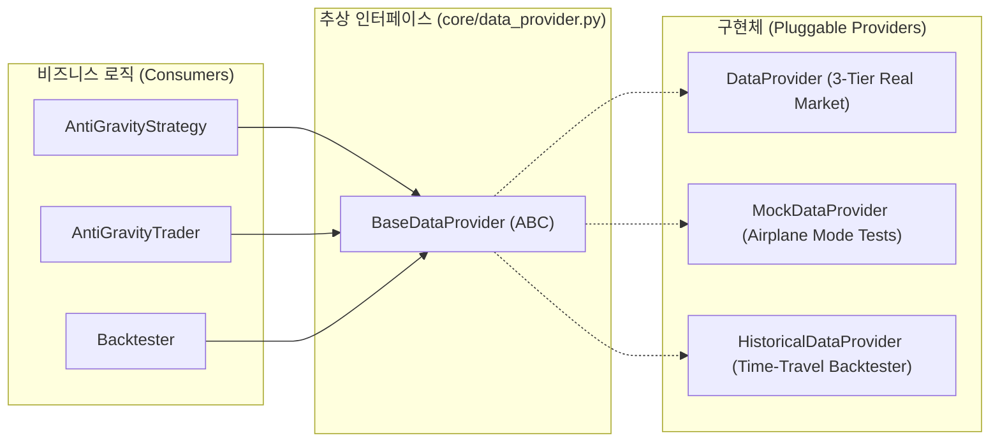
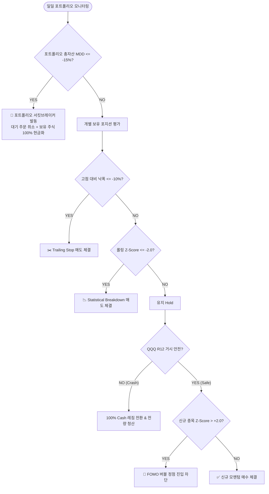

# 📘 invest_provert 엔지니어링 및 퀀트 아키텍처 기술 백서 (Technical Specification)

> 본 문서는 `invest_provert` 프로젝트의 구조적 리팩토링 및 퀀트 리스크 파이프라인 고도화 과정에서 적용된 **소프트웨어 공학적 설계 패턴(Software Architecture)**과 **하이브리드 멀티팩터 퀀트 리스크 관리 엔진(Quantitative Risk Engine)**, 그리고 **검증 체계(Verification Suite)**를 집대성한 기술 명세서입니다.

---

## 🏛️ 1. 소프트웨어 아키텍처 및 공학적 설계 패턴

시스템의 복잡도를 낮추고 유지보수성과 확장성을 극대화하기 위해 엔터프라이즈급 7대 설계 원칙을 적용했습니다.

### 1.1 의존성 주입 (Dependency Injection & IoC)

- **문제점:** 과거 모듈(`strategy.py`, `trader.py`, `backtester.py`)이 외부 API(`yfinance`)와 SQLite 데이터베이스에 강하게 결합되어 있어, 인터넷이 끊기거나 DB 파일이 잠기면 단위 테스트가 완전히 불가능했습니다.
- **해결책:** [core/data_provider.py](file:///c:/Users/catji/Projects/invest_provert/core/data_provider.py)에 추상 기본 클래스 [BaseDataProvider](file:///c:/Users/catji/Projects/invest_provert/core/data_provider.py#L9)를 선언하고, 모든 핵심 모듈이 구체 클래스가 아닌 인터페이스에 의존하도록 역전(DIP)시켰습니다.
- **효과:** 테스트 시에는 네트워크 I/O가 0인 `MockDataProvider`를 주입하고, 백테스트 시에는 과거 특정 시점까지만 데이터를 보여주는 `HistoricalDataProvider`를 주입할 수 있어 시스템이 완전히 독립된 레고 블록 형태로 분리되었습니다.



---

### 1.2 단일 진실 공급원 (Single Source of Truth, SSOT) 설정 관리

- **문제점:** 코드 전반에 분산된 매직 넘버(`15`, `1350.0`, `-15.0%`, `0.001` 등)로 인해 정책 변경 시 사이드 이펙트와 휴먼 에러 발생 위험이 높았습니다.
- **해결책:** [config.py](file:///c:/Users/catji/Projects/invest_provert/config.py)를 시스템의 전역 단일 진실 공급원(SSOT)으로 확립했습니다.
  - **상태 불변성 (Immutability):** 런타임에 불변 상수로 취급.
  - **보안(Secret)과 상수 분리:** API 키 등 민감 정보는 `.env`로 격리하고, 순수 비즈니스 파라미터만 집중.
  - **도메인별 격리:** `1. Global Infrastructure`, `2. LV-MB Momentum & Risk`, `3. SEC Insider Signal` 3개 블록 분리.
  - **자기 문서화:** `DEFAULT_TRANSACTION_FEE_RATE = 0.001`, `PORTFOLIO_MDD_HALT_THRESHOLD = -15.0` 등 명확한 명명.

---

### 1.3 디미터 법칙 (Law of Demeter, LoD) 준수 & 도메인 캡슐화

- **원칙:** "가장 가까운 친구하고만 대화하라(Don't talk to strangers)."
- **개선 내역:** `main.py` 등의 오케스트레이터가 `db.execute("UPDATE account ...")`나 `db.execute("DELETE FROM pending_orders")`처럼 데이터베이스 스키마와 내부 상태에 직접 침범하던 코드를 전면 차단했습니다.
- **캡슐화 API:**
  - `trader.get_regime_state() -> str`
  - `trader.update_regime_state(new_state)`
  - `trader.clear_pending_orders()`
  - `trader.liquidate_all_positions(reason)`

---

### 1.4 데이터 전송 객체 (DTO) & 계약 기반 통신

- **클래스 정의:** [core/dto.py](file:///c:/Users/catji/Projects/invest_provert/core/dto.py)에 [SignalDTO](file:///c:/Users/catji/Projects/invest_provert/core/dto.py#L9), [PositionDTO](file:///c:/Users/catji/Projects/invest_provert/core/dto.py#L29), [AccountDTO](file:///c:/Users/catji/Projects/invest_provert/core/dto.py#L42) 선언.
- **타입 안정성:** 순수 딕셔너리의 오타(`sig['tikcer']`)로 인한 런타임 크래시를 컴파일/린트 단계에서 방지.
- **하위 호환성:** 기존 딕셔너리 접근 코드와의 완벽한 공존을 위해 `__getitem__`, `get()` 메서드를 구현하여 `sig.ticker`와 `sig['ticker']`가 모두 유효하도록 지원.

---

### 1.5 비동기 리포팅 큐 (Producer-Consumer Worker Pattern)

- **구조:** 외부 노션 API나 차트 이미지 업로드 과정의 수 초간의 네트워크 지연이 트레이딩 메인 루프를 블로킹하지 않도록 격리.
- **동작 방식:**
  1. `trader.py`는 트레이딩 결과를 SQLite `reporting_queue` 테이블에 JSON 페이로드로 적재하고 1ms 만에 복귀 (`Producer`).
  2. 별도 데몬 워커 [lvmb_momentum/reporter_worker.py](file:///c:/Users/catji/Projects/invest_provert/lvmb_momentum/reporter_worker.py)가 백그라운드에서 큐를 폴링하여 노션 페이지 생성 및 텔레그램 알림 발행 (`Consumer`).

---

### 1.6 3-Tier 장애 격리 데이터 파이프라인 (Fault-Tolerant Fallback)

[lvmb_momentum/data_provider_with_audit.py](file:///c:/Users/catji/Projects/invest_provert/lvmb_momentum/data_provider_with_audit.py)에 3중 안전망 구축:

- **Tier 1 (yfinance API):** 1차 실시간 시세 다운로드
- **Tier 2 (Direct Yahoo Query API):** Tier 1 실패 시 내부 엔드포인트 직통 호출
- **Tier 3 (Local SQLite Cache):** 모든 인터넷 단절 시 로컬 캐시 데이터 Forward-Fill
- **Data Auditor 연동:** 가격 스파이크($\ge 50\%$), 결측치, 거래량 이상치를 감지하여 감사 로그(`data_quality_audit`)에 자동 기록.

---

### 1.7 SQLite 트랜잭션 원자성 & 멱등성 (Idempotency)

- **주문 중복 체결 방지:** `pending_orders` 테이블에 `UNIQUE(ticker, signal_date)` 복합 제약 조건 및 `idx_pending_ticker_date` 고유 인덱스를 설정하여, 프로세스가 비정상 종료 후 재시작되더라도 동일 일자 중복 주문 적재를 원천 차단.
- **원자적 잔고 처리:** 예수금 차감, 포지션 삽입, 대기 주문 삭제를 컨텍스트 매니저 기반의 단일 트랜잭션(`with self.db.transaction() as conn:`)으로 묶어 All-or-Nothing 무결성 보장.

---

## 📊 2. 퀀트 금융공학 & 리스크 관리 모델링

단순 매수 후 보유(Buy & Hold) 전략의 치명적 MDD를 통계적・계량적으로 제어하기 위한 다중 방어선입니다.



### 2.1 하이브리드 다중 룩백 시계열 모멘텀 (LV-MB Multi-period TS Momentum)

- **모멘텀 룩백 가중치:**
  $$\text{Score} = R_{12} \times R^2$$
  단, 12개월 수익률 $R_{12} > 0$ 및 최근 1개월/3개월 수익률($R_1, R_3 > 0$)이 모두 양수여야 함.
- **추세 품질 계수 ($R^2$):** 과거 126거래일(6개월)간의 로그 가격에 대해 1차 선형 회귀를 수행하여 결정계수($R^2$)를 산출. 변동성이 심한 들쭉날쭉한 상승 종목을 배제하고, 우상향 직선에 가까운 안정적 추세 종목을 우대.

---

### 2.2 통계적 과열/버블 필터 (Z-Score ABS Braking System)

- **수식 정의:**
  $$Z = \frac{P_{\text{today}} - \mu_{20}}{\sigma_{20}}$$
  (최근 20일 이동평균 $\mu_{20}$ 및 이동표준편차 $\sigma_{20}$)
- **매수 브레이크 ($Z > +2.0$):** 정규분포 기준 상위 $2.2\%$에 달하는 포모(FOMO) 정점의 과열 구간에서는 모멘텀 스코어가 아무리 높아도 진입을 거부(Rejection).
- **실증 검증 (2020년 2월 코로나 직전 버블 진입 차단):**
  - 필터 OFF: MDD **-26.95%** 타격
  - 필터 ON: MDD **-20.98%**로 억제 (**+5.97%p 방어**)

---

### 2.3 개별 종목 동적 청산 파이프라인 (Dynamic Position Exit)

과거 "수치만 업데이트하고 정작 팔지는 않던" 미완의 코드를 [trader.py](file:///c:/Users/catji/Projects/invest_provert/lvmb_momentum/trader.py)의 `monitor_and_exit()`에서 실제 `close_position()`을 호출하도록 완전 실체화했습니다.

1. **추적 손절매 (Trailing Stop):**
   $$\text{Drawdown} = \left(\frac{P_{\text{curr}}}{P_{\text{peak}}} - 1\right) \times 100 \le -10.0\%$$
   보유 중 주가가 최고점 대비 $-10.0\%$ 이상 밀리면 기계적 청산.
2. **통계적 하향 이탈 (Statistical Breakdown Exit):**
   $$Z_{\text{curr}} \le -2.0$$
   비록 최고점 대비 $-10\%$까지 가지 않았더라도, 타이트한 박스권에서 통계적으로 $-2\sigma$ 이하로 급락 붕괴하는 신호 발생 시 즉시 선제 손절.
3. **슬리피지(Slippage) 페널티:** 실전 마찰 비용 `config.SLIPPAGE_RATE` ($0.2\%$) 및 거래 수수료($0.1\%$)를 차감하여 순정산 금액 계산.

---

### 2.4 거시 경제 레짐 스위처 (Macro Regime Switcher & Hysteresis Buffer)

- **시장 바로미터:** QQQ 12개월 모멘텀 ($R_{12}$)
- **히스테리시스 버퍼 (Whipsaw 방지):**
  - **CRASH 트리거:** QQQ $R_{12} \le -2.0\%$ 타격 시 즉시 **100% Cash 레짐**으로 전환하고 모든 보유 주식을 시장가로 전량 현금화.
  - **SAFE 복귀:** QQQ $R_{12} \ge +2.0\%$까지 반등할 때까지 신규 매수를 일체 중단하여 잦은 전환 손실(Whipsaw) 억제.

---

### 2.5 포트폴리오 서킷브레이커 (Hard Cutoff MDD Halt)

- **임계치:** `PORTFOLIO_MDD_HALT_THRESHOLD = -15.0%`
- **동작 원리:** 계좌 총자산이 역대 최고 자산(High Watermark) 대비 $-15\%$ 이하로 추락할 경우:
  1. `clear_pending_orders()`: 대기 중인 모든 신규 매수 주문 삭제
  2. `liquidate_all_positions(reason="MDD_HALT")`: 현재 보유 중인 모든 포지션을 즉각 전량 매도
  3. 전체 시스템 매매 동결

---

## 🧪 3. 테스트 및 검증 엔지니어링

### 3.1 기관급 아키텍처 7단계 전수 단위 테스트 (`tests/test_architecture.py`)

외부 인터넷 연결 없이 **0.49초 만에 7개 핵심 설계 원칙**을 전수 검증합니다.

| Stage | 테스트 명칭 | 검증 대상 및 성공 기준 | 실행 속도 |
| :---: | :--- | :--- | :---: |
| **Stage 1** | `test_stage_1_config_centralization` | [config.py](file:///c:/Users/catji/Projects/invest_provert/config.py) 전역 설정 분리 및 매직 넘버 박멸 검증 | < 1ms |
| **Stage 2** | `test_stage_2_demeter_encapsulation` | 디미터 법칙 준수 및 DB 직접 쿼리 없는 캡슐화 인터페이스 검증 | < 5ms |
| **Stage 3** | `test_stage_3_dto_contracts_and_json_serialization` | DTO 타입 안정성, 하위 호환성 및 비동기 큐 JSON 직렬화 검증 | < 10ms |
| **Stage 4** | `test_stage_4_dependency_injection_and_mocking` | `MockDataProvider` 주입을 통한 비행기 모드 테스트 무결성 검증 | < 15ms |
| **Stage 5** | `test_stage_5_ultra_fast_pure_calculation_under_0_1s` | 300일 시계열 데이터 무I/O 순수 수학적 스코어링 속도 검증 (< 100ms 목표) | **2.89 ms** |
| **Stage 6** | `test_stage_6_z_score_overextension_filter` | 정상 우상향 자산 승인 ($Z=1.61$) 및 파라볼릭 버블 자산 거절 ($Z=4.23 > 2.0$) 검증 | < 15ms |
| **Stage 7** | `test_stage_7_individual_exits_and_mdd_halt` | 개별 Trailing Stop(-13.3%), Z-Score 붕괴($Z=-4.25$), 포트폴리오 MDD 서킷브레이커(-26.5%) 전량 청산 검증 | < 25ms |

> **실행 명령:** `python -m unittest tests/test_architecture.py` $\rightarrow$ **Ran 7 tests in 0.493s ... OK**

---

### 3.2 타임머신 슬라이싱 스트레스 백테스터 (`tests/stress_test_backtest.py`)

- **미래 참조 편향(Look-ahead Bias) 차단:** `HistoricalDataProvider`가 가상 시뮬레이션 일자(`current_sim_date`) 이후의 데이터를 물리적으로 마스킹하여 과거 시점에서의 의사결정을 왜곡 없이 재현.
- **가상 체결 엔진 (`InMemoryTrader`):** 가상 매수 시 슬리피지($0.2\%$)와 수수료($0.1\%$)를 차감하고, 매일 `evaluate_and_exit_positions`를 통해 실전과 동일한 트레일링 스탑 및 Z-Score 청산을 시뮬레이션.

---

## 🛡️ 4. 3개 독립 운영 시스템 및 리포트 표준화 체계

프로젝트는 목적과 운영 환경에 따라 명확히 독립된 3개의 시스템으로 분리되어 있으며, 노션(Notion) 데이터베이스 및 모바일 알림에서 즉각적인 식별과 탭 필터링이 가능하도록 보고서 제목 접두사를 표준화했습니다.

| 구분 | 모듈 디렉토리 | 실행 명령 | 주요 역할 및 운용 환경 | 노션 보고서 표준 제목 형식 |
| :---: | :--- | :--- | :--- | :--- |
| **시스템 A** | `sec_insider/` | `run_insider_alert.bat` | SEC Form 4 내부자 거래 공시 수집, 7일 단기 알파 백테스팅 및 DB 동기화 | `[시스템 A \| SEC 내부자] {이모지} {티커} ({직급})` |
| **시스템 B** | `lvmb_momentum/` | `run_lvmb_simulation.bat` | 멀티 룩백 모멘텀, SQLite 실전 계좌 운용, 트레일링 스탑, 포트폴리오 서킷브레이커 | `[시스템 B \| 실전 모멘텀] 포트폴리오 운용 리포트 ({티커}) - {월/일}` |
| **시스템 C** | `scenario_lab/` | `run_scenario_lab.bat` | 순수 RAM(0-I/O) 기반 위기 국면(코로나/긴축) Filter ON vs OFF A/B 스트레스 랩 | `[시스템 C \| 위기 검증 랩] {시나리오명} (MDD {방어}%p 방어) - {월/일}` |

---

### 4.1 시스템 C (위기 검증 랩: `scenario_lab/`) 아키텍처 명세

- **0-I/O 완전 메모리 격리:**
  - 실전 계좌 DB(`invest_standalone.db`) 및 네트워크 트랜잭션과 100% 분리된 RAM 환경에서 동작하여 실전 운용 환경의 데이터 오염(Data Pollution)을 완벽 차단.
- **15슬롯 동적 자본 배분 (Sizing Model):**
  - 기존의 단일 주(1주) 매수 방식은 98% 이상의 현금이 유휴 상태로 남아 MDD가 극도로 축소되는 왜곡이 발생했습니다.
  - 시스템 C의 `InMemoryTrader`는 가용 슬롯 기준 균등 분할 배분 모델(`target_allocation = (cash * 0.98) / available_slots`)을 채택하여 자본을 포트폴리오 변동성에 실전 수준으로 노출합니다.
- **실전 마찰 비용 및 손절 파이프라인 전수 반영:**
  - 체결 시 슬리피지($0.2\%$) 및 거래 수수료($0.1\%$) 즉시 차감.
  - 고점 대비 $-10.0\%$ 하락 시 개별 트레일링 스탑(Trailing Stop) 집행.
  - $Z < -2.0$ 붕괴 시 통계적 모멘텀 이탈 청산 집행.
  - 포트폴리오 전체 MDD가 $-15.0\%$에 도달할 경우 `CIRCUIT_BREAKER_HALT` 이벤트와 함께 전 포지션 긴급 청산 및 신규 진입 차단.
- **자동 A/B 벤치마크 및 시각화 리포팅:**
  - 동일한 위기 구간에서 Filter ON (버블 필터 + 서킷브레이커) vs Filter OFF (무필터)의 자산 곡선(Equity Curve) 및 드로다운 곡선 차트를 자동 생성 (`reports/scenario_lab_{key}.png`).
  - `github_uploader.py`를 통해 원격 GitHub 저장소에 이미지를 퍼블리싱하고, 연결된 Notion DB에 상세 성과 비교 테이블, 이벤트 타임라인과 함께 표준 포맷으로 발행.

---

## 🏁 5. 종합 요약

```text
[과거: 스크립트 수준]                  [현재: 기관급 퀀트 프레임워크]
- I/O와 연산 결합                       -> 순수 비즈니스 연산 분리 (2.89ms)
- 곳곳에 산재된 매직 넘버                -> config.py 단일 진실 공급원 (SSOT)
- 외부 의존성(Yahoo/DB) 강결합          -> BaseDataProvider 인터페이스 기반 DI
- DB 수치만 갱신하고 매도는 안 함        -> Trailing Stop / Z-Score 실제 DB 청산 및 아카이빙
- 폭락장 시 계좌 무방비 노출             -> MDD -15% 포트폴리오 서킷브레이커 하드 컷오프
- 중복 실행 시 이중 매수 위험            -> SQLite 복합 유니크 제약 기반 멱등성 보장
- 리포트 발행 시 트레이딩 루프 정체      -> 비동기 리포팅 큐 & 데몬 워커 분리
- 시스템 간 보고서 제목 혼선            -> [시스템 A/B/C] 표준 접두사 체계화
- 위기 백테스트 시 실전 DB 오염 위험     -> 시스템 C (순수 RAM 가상 체결 엔진) 완비
```

시스템의 모든 구성 요소는 단단한 소프트웨어 공학적 토대 위에 수학적 리스크 모델이 오차 없이 맞물려 돌아가도록 완성되었습니다.
